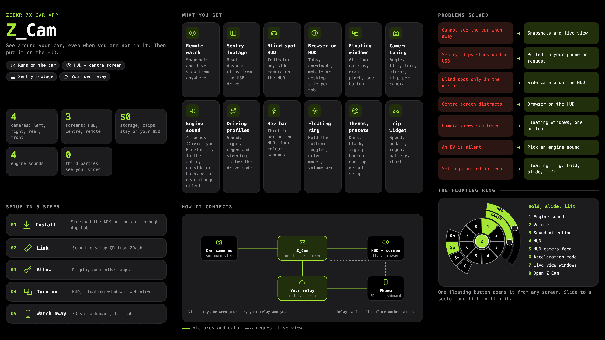

# Z_Cam (companion app for the Zeekr 7X head unit)

An Android app that runs **on the Zeekr 7X head unit** (sideloaded through App Lab). It
uses the car's own cameras through standard **Camera2**. It works standalone, and can
optionally talk to **your own deployed relay** over a paired token for uploads and remote
features. Current version: see `app/build.gradle.kts`.

One-pager: [open the one-pager](https://jacklcw.github.io/Z_Cam/docs/zcam-onepager.html).



## What it does

- **Blind-spot HUD.** When the left or right indicator is on, the matching side camera is
  shown on the car's **HUD** display, and it disappears shortly after the indicator goes off.
  - The side panel is flattened from its fisheye with a virtual camera (OpenGL), so you get a
    natural picture instead of a circle.
  - Per side (left and right are saved separately): picture size, view angle, tilt up, turn
    toward the rear, rotate, and mirror. The HUD previews live while you drag a slider.
  - Tuned defaults for each side, and a **Reset this side to default** button.
  - Needs the "Display over other apps" permission.
- **Live view tuning and floating windows.** Left, right, rear and front cameras are tuned in
  one **Live view** section (angle, tilt, turn, rotate, mirror, flip) and shown as floating
  windows; a floating button hides or shows them all. **Web view** is a small browser with
  tabs, bookmarks, history and downloads. A More menu holds Full screen (its own full-size page on
  the centre screen), Mobile / Desktop site (remembered per tab), Bookmarks, History and Downloads.
  Files save to Downloads and an APK opens the installer. Drag a window's corner line to resize it.
- **Rev bar.** A throttle-pedal bar on the HUD (top, bottom, or a funnel on the right), with
  smooth / segmented / slanted styles, four colour schemes, size and edge-gap sliders and a live
  in-app preview. Press and hold the floating button for quick toggles (engine sound, rev bar,
  web on HUD, HUD side camera, rear/front window): slide to one and lift to flip it.
- **Engine sound.** A simulated engine that follows throttle and speed in every drive mode (Civic Type R,
  American V8, Prototype V8 and Turbo four; Civic Type R is the default), played in the
  cabin, outside, or both. Gear changes have their own effects (upshift bang, ignition cut,
  downshift blip with crackle, gear thump), and the Civic Type R adds more bass while parked. The
  cabin and outside volumes are separate: in outside mode only the outside volume applies. Ported
  from Zeekr Shortcut (GPL-3.0).
- **Apply default settings.** One button sets up windows, camera tuning, HUD, web window, engine
  sound, driving profiles, trip widget and theme the way the author uses them. It asks first, works
  without ZDash and keeps your relay link, bookmarks and history.
- **Back up and restore.** Covers windows, camera tuning, HUD, web, engine sound, driving profiles,
  the trip widget, rev bar and theme (needs a linked relay). Long press the button to choose which
  groups a backup includes.
- **Auto Camping-off.** Optionally turns Camping mode off when it was left on after getting out:
  both front seats empty and the car locked for a chosen number of minutes. Any doubt restarts the wait.
- **Data usage.** A built-in meter shows what the app sends and receives, per category and day.
- **Driving profiles.** One profile per drive mode: engine sound, ambient light (follows speed),
  regen, steering weight and rev bar all follow the mode you switch to, with an optional silent
  profile per mode.
- **Floating button guide.**
  - **Tap** the floating button once: every floating window (cameras, web, trip) minimizes into
    the bar at the top centre. Tap it again: they all come back.
  - **Press and hold** (keep your finger still) to open the quick-toggle ring. Slide to a sector
    and lift to flip it; the name shows at the top. Sectors: Engine sound, Volume (cabin / outside
    arcs), Sound direction, HUD (rev bar, web on HUD, HUD side camera, turn arrow), Acceleration
    mode, Floating windows (left, right, rear, front, web, trip) and Open Z Cam. Lift away from
    every sector to close the ring.
  - **Drag** the button to move it, **pinch** it to resize it. It can be switched off with
    "Quick-hide button" under Floating windows in settings.
- **Floating ring.** Press and hold the floating button for a ring of quick toggles and a
  drive-mode ring; the volume arcs (cabin or outside engine sound, web) are labelled and only the
  arc for the chosen sound direction is shown.
- **Sentry snapshots.** Manual capture, uploaded to the
  relay (motion detection is left to the car's own Sentry) and shown in the dashboard **Cam** tab. Idle means no upload.
- **Live view.** On request from the dashboard, a few-frames-per-second stream over a
  WebSocket the car dials out (works behind cellular NAT).
- **Sentry video clips.** Browse the clips on the car's USB drive, request one from the
  dashboard, and it is uploaded in small resumable pieces (a request can be cancelled).
- **Updates.** Update by sideloading the newest APK from `release/latest/`. The app can show an
  update banner, but only when your relay has a `GH_TOKEN` secret that can read this repo's
  `camera-app/release/latest/`; without it, and in standalone mode, there is no in-app update.
- **On-device log viewer** and remote log upload for debugging.
- **Credits.** A Credits button in the left column lists the projects and people this app builds on.
- **UI.** Same look as the ZDash dashboard: Dark / Black / Light themes, fixed lime
  accent, large buttons for the car screen.

## Build

```
cd camera-app
./gradlew assembleRelease     # APK in app/build/outputs/apk/release/
```

Needs JDK 17 and the Android SDK. The release build is debug-signed so it sideloads via
App Lab. Released APKs are kept in `release/` and the newest in `release/latest/`.

## Install and link

1. Sideload the APK through **App Lab**. Grant Camera, Notifications and, for the
   blind-spot HUD, Display over other apps.
2. **Standalone:** tap **Use without Z app**. The blind-spot HUD, floating cameras and web
   window work with no relay and no phone.
3. **Linked (remote snapshots, live view, clips):**
   - On the first screen, scan the setup QR with the ZDash app (App settings, Z_Cam, Scan QR
     from car). Your phone sends your relay address to the car, and you confirm it on the
     car. The QR expires after 10 minutes and can be switched off, or you can type the
     address instead.
   - In Z_Cam tap **Get pairing code**, then scan that QR in the same ZDash screen. The car
     shows **Linked** within a few seconds.
4. Pick the camera (`2` is the surround view) and **Start service**.

Privacy of the setup QR: the relay address passes through the public ntfy.sh service
(a one-time random topic, kept about 12 hours, visible to anyone holding the QR). Nothing
else is sent, and linking itself goes straight to your own relay.

## How the blind-spot HUD works

- Camera `2` is one stream of four stacked fisheye panels: front, rear, left, right. The
  left and right panels are the cameras under the side mirrors, looking out sideways.
- The indicator is read from the car's ECARX adapter API (`getFunctionValue(0x2A091500)`:
  0 off, 1 left, 2 right, 3 hazard) by reflection. No permission is needed inside App Lab.
- The HUD is a non-default display (1440x480 on the 7X), and the overlay is a
  `TYPE_APPLICATION_OVERLAY` window created on that display.
- The picture is only as sharp as the camera HAL gives: each panel is about 280 rows.
- While the HUD feed is open, snapshots and live view report "camera busy".
- It is a driving **aid only**. Always check mirrors and your surroundings.

## Notes and limits

- Head units kill background apps and the modem sleeps when parked, so uploads happen
  only while the unit is awake and online.
- Experimental, unofficial, and not affiliated with ZEEKR. Use at your own risk.

## Credits

The platform facts this app relies on were learned from other people's on-car research:

- **[dts88/zeekr-shortcut-car](https://github.com/dts88/zeekr-shortcut-car)** (Zeekr Shortcut /
  EVCam fork, GPL-3.0; engine sound code ported, shown in the app credits line): camera id layout of the 7X surround stream, the ECARX indicator
  function, and the HUD display details.
- **[jlunnn/CarPiano](https://github.com/jlunnn/CarPiano)** (MIT): on-car facts about playing
  sound to the 7X speakers (an output device must be set, the exterior speaker bus). Facts only,
  no code.
- **[EngineV1](https://evenginev1.com)** (commercial site, used as a reference): the engine sound's
  frequency character was checked against its public demo, as the Zeekr Shortcut authors did.
  Facts only, no recordings or code.
- **[FerixzTanz](https://github.com/FerixzTanz)** (CAMCORDER): the original on-car research
  for showing the side camera on the HUD, which the above project builds on.

The code in this folder is written from scratch, with one exception: the simulated engine sound
(`app/src/main/java/com/zeekr/sentrycam/sound/`) is ported from dts88/zeekr-shortcut-car and stays
under **GPL-3.0** (see the `NOTICE.md` and `LICENSE-GPL-3.0.txt` there). The Z_Cam app built from
this folder is therefore distributed under GPL-3.0.

Third-party libraries and services this app uses:

- **[ZXing](https://github.com/zxing/zxing)** (Apache-2.0): draws the setup QR.
- **[OkHttp](https://github.com/square/okhttp)** (Apache-2.0): networking, WebSocket and the
  setup listener.
- **[AndroidX / AppCompat](https://developer.android.com/jetpack/androidx)** (Apache-2.0).
- **[ntfy.sh](https://ntfy.sh)** (Apache-2.0 / GPL-2.0): public pub/sub service used once
  to hand your relay address from the phone to the car during setup.
